  
 
    

---

## About Me

I build **machine learning systems, NLP/RAG applications and cloud data pipelines** that make it out of the notebook and into production. I've worked as a **Data Analyst at Accenture** and now do research at **UMBC's Data Analytics Lab**, using **Python, Spark, TensorFlow and Azure Databricks**. My automation work has cut manual effort by **25–40%**.

I'm currently pursuing an **M.S. in Data Science at UMBC** (graduating Dec 2026), after a B.Tech in Computer Science & Engineering.

-  **Open to:** Data Scientist · ML Engineer · Data Analyst · SDE/SWE · Solutions Architect roles
-  **Building:** end-to-end ML pipelines, LLM/RAG applications, big-data engineering, NLP systems
-  **Learning:** LLM fine-tuning, advanced deep learning, distributed systems, cloud-native architecture
-  **Ask me about:** RAG, NLP, PySpark, ETL/ELT, Azure Databricks, Power BI, deep learning

---

##  Tech Stack

  

| Area | Tools |
| --- | --- |
| **Languages** | Python, SQL, Java, Scala, JavaScript, Bash |
| **ML & AI** | TensorFlow, Keras, PyTorch, scikit-learn, Hugging Face, RAG, LSTM, transfer learning |
| **Big Data & Cloud** | Spark / PySpark, Hadoop, Kafka, Databricks, Snowflake, AWS, Azure |
| **Databases** | PostgreSQL, MySQL, MongoDB, Cosmos DB, ChromaDB |
| **ETL & DevOps** | Azure DevOps, Docker, Git, CI/CD, Jira, Oracle Data Integrator |
| **BI & Web** | Tableau, Power BI, Plotly, React, Flask |

---

##  Featured Projects

  
  
  
  
  
  

<b>Read the full project write-ups</b>

### [DermaFusion](https://github.com/RahulReddyKota/DermaFusion): Skin Cancer Detection
A CNN that uses **ResNet50 and VGG16 transfer learning** to classify HAM10000 dermoscopic images as malignant or benign.
- **90%+ validation accuracy** using augmentation, class weighting and batch normalization
- **Grad-CAM** heatmaps explain predictions across all seven lesion categories
- Evaluated with confusion matrices, ROC-AUC and per-class F1
- Recognized at **AI RADA and Healthcare** (Jan 2026)

`Python` `TensorFlow` `Keras` `ResNet50` `VGG16` `OpenCV` `Grad-CAM` `Healthcare AI`

### [ARC AI](https://github.com/RahulReddyKota/ARC-AI-Augmented-Reasoning-Core): RAG Assistant for Maryland Housing Law
A local-first **Retrieval-Augmented Generation** system that answers tenant–landlord questions with citations to seven official Maryland sources.
- Sentence-transformer embeddings stored in **ChromaDB**
- Switch between **Llama 3.1 8B, Mistral 7B and Qwen 2.5 7B** in real time via Ollama
- Nine NLP layers, including NER, extractive QA, intent classification and sentiment
- Evaluation harness that scores citation accuracy, hallucination rate and coherence

`Python` `ChromaDB` `Ollama` `Llama 3.1` `Mistral` `RAG` `NLP` `Legal AI`

### Big Data Job Market Analysis
A distributed **AWS EMR** pipeline that uses **PySpark and Hive** to process millions of raw job postings.
- Schema-on-read, window functions and partitioned ORC storage keep queries fast
- **Power BI** dashboard shows skill demand, salary benchmarks and regional hiring, with drill-through

`PySpark` `Hive` `AWS EMR` `S3` `Power BI` `SQL`

### Trading on Trends: Stock Sentiment Analysis
Combines **FinBERT** sentiment on financial headlines with RSI, MACD and Bollinger Band features to predict next-day price direction.
- Benchmarks **LSTM against Random Forest**
- Stores predictions in SQL for back-testing

`Python` `FinBERT` `LSTM` `Random Forest` `Pandas` `SQL`

### Cyberbullying Detection with Neural Networks
A **Bi-LSTM + GloVe (100d)** classifier that sorts text into six categories.
- Beats SVM and Naive Bayes baselines on macro F1
- Includes an ablation study comparing static and fine-tuned embeddings

`Python` `TensorFlow` `Bi-LSTM` `GloVe` `NLTK`

---

## Experience

| Role | Organization | Period |
| --- | --- | --- |
|  **Research Assistant**, Data Analytics Lab | University of Maryland, Baltimore County | Feb 2025 – Present |
|  **Data Analyst** | Accenture, Hyderabad | Aug 2023 – Nov 2024 |
|  **Data Analyst Intern** | Accenture, Hyderabad | May 2022 – May 2023 |

**UMBC:** Built SQL and Python pipelines for faculty research, cutting manual preprocessing by about **40%**. Also built Power BI dashboards and wrote ETL documentation and data dictionaries.

**Accenture:** Led a post-merger data migration, optimizing ETL with Oracle Data Integrator, SQL and Azure Databricks, and restructured Cosmos DB into a Databricks Lakehouse. Automated CI/CD with Azure DevOps and built Tableau KPI dashboards that cut manual effort by **25%**.

---

## Education

| Degree | Institution | GPA | Period |
| --- | --- | --- | --- |
|  **M.S. Data Science** | University of Maryland, Baltimore County | 3.8 / 4.0 | Jan 2025 – Dec 2026 |
|  **B.Tech, Computer Science & Engineering** | Sreenidhi Institute of Science & Technology | 3.5 / 4.0 | Aug 2019 – Jul 2023 |

## Certifications

---

##  GitHub Activity

  
  

---

  <i>"The goal is to turn data into information, and information into insight."</i>  
  

